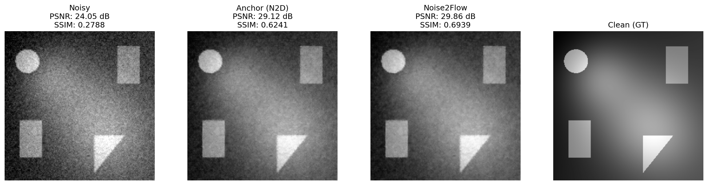

# Noise2Flow

[](https://doi.org/10.1117/1.JMI.13.6.064002)
[](https://doi.org/10.1117/1.JMI.13.6.064002)

This repository contains the code for the paper:

> **Noise2Flow: single-image conditional mean denoising flows from weak-anchor couplings**<br>
> Yipeng Sun, Linda-Sophie Schneider, Mingxuan Gu, Siyuan Mei, Chengze Ye, Linghan Cai, Jinhua Wang, Ge Hu, Daiqi Liu, Zijin Yang, Fei Wu, Siming Bayer, Lan Song, Andreas Maier<br>
> *Journal of Medical Imaging* 13(6), 064002 (2026).
> [https://doi.org/10.1117/1.JMI.13.6.064002](https://doi.org/10.1117/1.JMI.13.6.064002)

Noise2Flow removes noise from one noisy image.
It does not use clean images or a training dataset.
The method also applies to spatially correlated noise, such as the noise in low-dose computed tomography (CT).



*Demo result on a synthetic image with spatially correlated noise.*

## Method

Noise2Flow trains one small network for each noisy image.

1. A weak single-image denoiser calculates an anchor from the noisy image.
2. The displacement from the noisy image to the anchor gives a direction.
3. A flow network learns this direction with a weighted cosine loss. The loss ignores the magnitude of the displacement.
4. During training, the method samples states in a stochastic tube around the line from the noisy image to the anchor.
5. After training, a one-dimensional calibration fits the anchor scale `b`.
6. Inference uses one forward pass of the flow network:

   ```text
   x_hat = clip(y + B * v(y, y)),  B = alpha * b
   ```

Here, `y` is the noisy image, `v` is the learned direction field, and `B` is the transport budget.
The extrapolation factor `alpha` is 1.15.
With `alpha` larger than 1, the output moves past the anchor, which still contains residual noise.
Inference does not use the weak denoiser.

## Scope of this repository

This repository contains a compact implementation of Noise2Flow with one anchor, Noise2Detail.
The experiments in the paper use two anchors, [Filter2Noise](https://github.com/sypsyp97/Filter2Noise) and Noise2Detail.
The demo runs on a synthetic image and does not reproduce the tables in the paper.

## Installation

1. Clone the repository.

   ```bash
   git clone https://github.com/sypsyp97/noise2flow.git
   cd noise2flow
   ```

2. Install the packages.

   ```bash
   pip install -r requirements.txt
   ```

Note: A CUDA GPU decreases the run time. If no GPU is available, the code uses the CPU.

## Quick start

Run the demo:

```bash
python main.py
```

The demo does these steps:

1. It makes a synthetic 256 × 256 image and adds noise.
2. It calculates the Noise2Detail anchor.
3. It trains the flow network and calibrates the anchor scale `b`.
4. It prints the peak signal-to-noise ratio (PSNR) and the structural similarity (SSIM).
5. It saves `comparison_matrix.png` in the current directory and shows the figure.

## Denoise your image

The input must be a 2D NumPy array with values in the range [0, 1].

```python
import numpy as np

from config import Config
from main import denoise

noisy = np.load("noisy.npy").astype(np.float32)  # shape (H, W), range [0, 1]

cfg = Config()
result = denoise(noisy, cfg)

denoised = result["denoised"]
```

`denoise` returns a dictionary with these keys:

| Key | Content |
| --- | --- |
| `denoised` | Output image of Noise2Flow |
| `anchor_n2d` | Noise2Detail anchor |
| `learned_B` | Calibrated anchor scale `b` |
| `infer_strength` | Transport budget `B = alpha * b` |
| `metrics` | PSNR and SSIM. Available only if you also give a clean image. |

To calculate the metrics, give the clean image as the third argument: `denoise(noisy, cfg, clean)`.

## Configuration

All parameters are in `config.py`. The defaults agree with the values in the paper.

| Parameter | Default | Symbol in the paper | Function |
| --- | --- | --- | --- |
| `flow_train.steps` | 1000 | `T` | Number of training steps of the flow network |
| `flow_train.lr` | 1e-4 | `eta` | Learning rate of the flow network (AdamW) |
| `flow_train.patch` | 128 | `h_p`, `w_p` | Patch size |
| `flow_train.batch` | 8 | | Number of patches for each step |
| `flow_train.rho` | 0.5 | `rho` | Scale factor of the tube radius |
| `flow_train.sigma_cap` | 0.03 | `sigma_cap` | Upper limit of the tube radius |
| `strength_learn.steps` | 1000 | `T_b` | Number of calibration steps |
| `strength_learn.lr` | 1e-2 | `eta_b` | Learning rate of the calibration (Adam) |
| `strength_learn.init_strength` | 0.20 | `b_0` | Initial value of the anchor scale |
| `strength_learn.infer_multiplier` | 1.15 | `alpha` | Extrapolation factor |
| `flow_infer.mode` | `onestep` | | `onestep` or `integrate` |
| `flow_infer.infer_steps` | 10 | `N` | Number of steps in `integrate` mode |
| `flow_infer.integrator` | `heun` | | `heun` or `euler` in `integrate` mode |
| `n2d.iters` | 1000 | | Number of updates for each Noise2Detail stage |
| `runtime.seed` | 42 | | Random seed |

## Repository structure

| File | Content |
| --- | --- |
| `main.py` | `denoise` function and demo |
| `config.py` | Parameters |
| `model.py` | U-Net of the flow network |
| `loss.py` | Weighted cosine loss |
| `training.py` | Patch sampler with flips and rotations |
| `inference.py` | One-step inference and multi-step integration |
| `n2d.py` | Noise2Detail anchor |
| `utils.py` | Tensor conversion and synthetic test image |

## Results in the paper

The paper reports these mean values:

| Dataset | PSNR | SSIM | Difference to Filter2Noise | Difference to Noise2Detail |
| --- | --- | --- | --- | --- |
| Fluorescence Microscopy Denoising test set, 48 images | 34.91 dB | 0.887 | +0.52 dB | +1.00 dB |
| Mayo Clinic low-dose CT, 1311 slices from 10 patients | 28.82 dB | 0.714 | +0.91 dB | +1.23 dB |

One-step inference is within 0.11 dB of 10-step Heun integration.
Refer to the [paper](https://doi.org/10.1117/1.JMI.13.6.064002) for the full protocol and the ablations.

## Citation

If you use this code, cite the paper:

```bibtex
@article{sun2026noise2flow,
  author  = {Yipeng Sun and Linda-Sophie Schneider and Mingxuan Gu and Siyuan Mei and Chengze Ye and Linghan Cai and Jinhua Wang and Ge Hu and Daiqi Liu and Zijin Yang and Fei Wu and Siming Bayer and Lan Song and Andreas Maier},
  title   = {{Noise2Flow}: single-image conditional mean denoising flows from weak-anchor couplings},
  journal = {Journal of Medical Imaging},
  volume  = {13},
  number  = {6},
  pages   = {064002},
  year    = {2026},
  doi     = {10.1117/1.JMI.13.6.064002},
  url     = {https://doi.org/10.1117/1.JMI.13.6.064002}
}
```

## License

The authors have not selected a license for this repository.
